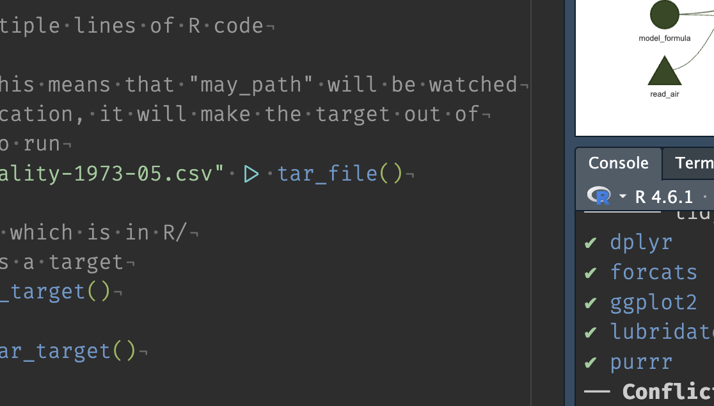
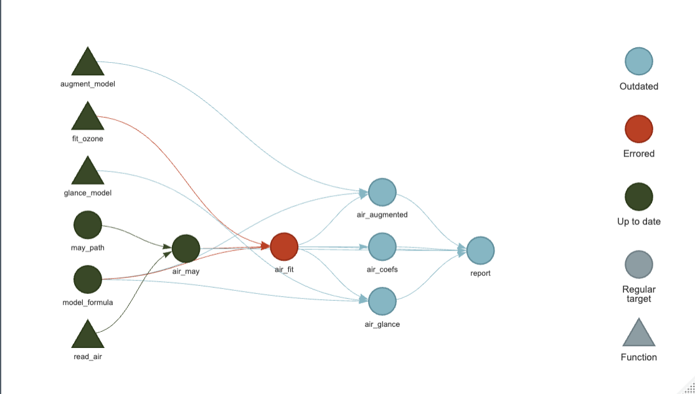

# Template for targets

This is a repo that contains a working small example of a targets workflow.

This is designed for copying and using in your own work.

Below are some ideas and suggestions on using targets

# Running targets

To run the entire targets pipeline, do the following:

```r
targets::tar_make()
```

To run a specific target:

```r
targets::tar_make(air_fit)
```

# Visualising targets

Use 

```r
tar_visnetwork()
```

To visualise your targets, to produce something like:



# Loading targets

Load targets into your session with `tar_load()`. E.g.,

```r
tar_load(air_fit)
air_fit
```

Load all targets with:

```r
tar_load_everything()
```

# Reading targets

You can read targets in to your session with `tar_read()`, e.g.,

```r
air_fit <- tar_read(air_fit)
air_fit
```

The names don't have to match the target! This is fine:

```r
example_of_a_long_variable_name <- tar_read(air_fit)
example_of_a_long_variable_name
```

# Debugging targets

I recommend debugging targets using function debugging tools like `debugonce()` or `browser()`.

E.g., if I had an error in `fit_ozone()` I would do:

```r
source("packages.R")
tar_source("R")
tar_make(air_fit) # if this errors:
tar_load(air_may)
tar_load(model_formula)
debugonce(fit_ozone)
fit_ozone(
    data = air_may,
    formula = model_formula
  )
```

And debug inside of `fit_ozone()`.

Also, work noting that `tar_visnetwork()` shows your error, too.



To save the hassle of doing `tar_load()`, etc, you can use `tar_workspace()`. 

(Note that this only works if your targets pipeline errors.)

If target `air_fit` errored - use `tar_workspaces()` (plural) to list the workspaces available:

```r
tar_workspaces()
```

```
[1] "air_fit" 
```

Then explore them with `tar_workspace()` (singular):

```r
tar_workspace("air_fit")
```

This does all the work of loading the required targets - so instead of:


```r
source("packages.R")
tar_source("R")
tar_make(air_fit) # if this errors:
tar_load(air_may)
tar_load(model_formula)
debugonce(fit_ozone)
fit_ozone(
    data = air_may,
    formula = model_formula
  )
```

You do:

```r
tar_workspace("air_fit")
debugonce(fit_ozone)
fit_ozone(
    data = air_may,
    formula = model_formula
  )
```

Read more at https://books.ropensci.org/targets/debugging.html

## Other useful things

- `tar_errored()`

- List out your tar


## tar_meta()
## tar_meta(fields = error, complete_only = TRUE)
## tar_manifest()


## Projects

You can have multiple targets projects, that will be in an upcoming repository.